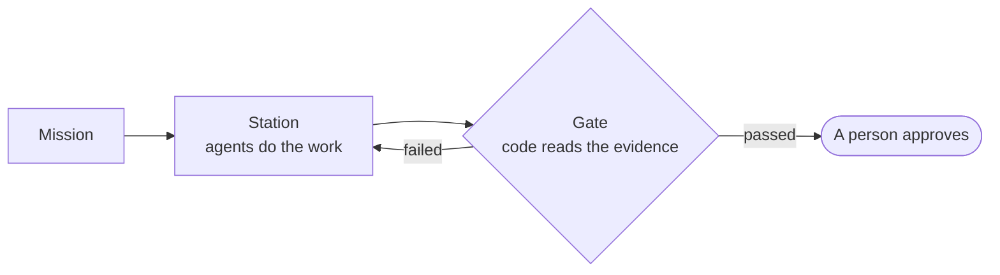

<div align="center">

# Pydantic AI Factory

**AI factories that prove their work. Built on Pydantic AI.**

[](https://github.com/hnrly/pydantic-ai-factory/actions/workflows/ci.yml)
[](https://github.com/hnrly/pydantic-ai-factory/blob/main/pyproject.toml)
[](https://github.com/hnrly/pydantic-ai-factory/blob/main/LICENSE)
[](https://hnrly.github.io/pydantic-ai-factory/)

</div>

An agent saying it finished is not the same as the work being right. Pydantic AI Factory is a Python library that separates the two. A factory takes a mission, moves the work through stations, and lets plain-code gates judge the recorded evidence before a person approves the result. Your agents stay ordinary Pydantic AI agents.



The first factory, for software, has one working station today: Design.

## Try it

```bash
git clone https://github.com/hnrly/pydantic-ai-factory
cd pydantic-ai-factory
uv sync
uv run factory run "A to-do list web page where I can add tasks and tick them off." --offline
```

That drafts a design for a to-do list web page, has fresh reviewers check it, and asks you to approve it. It needs no model key. In Python it is four lines:

```python
from pydantic_ai_factory import MemoryStore
from pydantic_ai_factory_software import SoftwareFactory

software = SoftwareFactory("anthropic:claude-opus-5-5")
run = software.run_sync("A to-do list web page where I can add tasks and tick them off.", store=MemoryStore())
```

[Getting started](https://github.com/hnrly/pydantic-ai-factory/blob/main/docs/getting-started.md) builds a factory of your own; [the software factory](https://github.com/hnrly/pydantic-ai-factory/blob/main/docs/software-factory.md) explains what this command did.

> **Status: alpha, v0.1.** The public API may change before 1.0. The [changelog](https://github.com/hnrly/pydantic-ai-factory/blob/main/CHANGELOG.md) lists every change you can see.

## Why a factory

Did the station run? Did its output pass a gate that reads real evidence? A factory keeps those two questions apart, and keeps the records that answer them. That is what this library adds on top of Pydantic AI's agents and capabilities.

| Idea | What it means here |
|---|---|
| Mission | What the factory commits to, with measurable success criteria. A string becomes one. |
| Factory | A named, ordered list of stations, with bounded rework. |
| Station | One bounded job with typed input and output. It names the agents it runs, if any. |
| Gate | Plain code that judges recorded evidence. A model never decides a gate. |
| Artifact | An unchangeable, content-addressed record of what a station handed on. |
| Methodology | A Pydantic AI capability with a name, a version, the evidence it records and a gate that judges it. |

"Capability" always means Pydantic AI's own `AbstractCapability`. The library adds no second meaning.

## What is here today

- [Getting started](https://github.com/hnrly/pydantic-ai-factory/blob/main/docs/getting-started.md): build a factory of your own and run a mission through it.
- [The software factory](https://github.com/hnrly/pydantic-ai-factory/blob/main/docs/software-factory.md) and its first station, [Design](https://github.com/hnrly/pydantic-ai-factory/blob/main/docs/design-station.md).
- Concepts: [factories](https://github.com/hnrly/pydantic-ai-factory/blob/main/docs/factories.md), [stations](https://github.com/hnrly/pydantic-ai-factory/blob/main/docs/stations.md), [agents in stations](https://github.com/hnrly/pydantic-ai-factory/blob/main/docs/agents.md), [gates](https://github.com/hnrly/pydantic-ai-factory/blob/main/docs/gates.md), [approvals](https://github.com/hnrly/pydantic-ai-factory/blob/main/docs/approvals.md), [stores](https://github.com/hnrly/pydantic-ai-factory/blob/main/docs/stores.md), [missions and signals](https://github.com/hnrly/pydantic-ai-factory/blob/main/docs/missions.md) and [methodologies](https://github.com/hnrly/pydantic-ai-factory/blob/main/docs/methodologies.md).
- The methodology that ships: [Elephant Goldfish](https://github.com/hnrly/pydantic-ai-factory/blob/main/docs/elephant-goldfish.md).
- [Observability](https://github.com/hnrly/pydantic-ai-factory/blob/main/docs/observability.md) and [measuring a methodology](https://github.com/hnrly/pydantic-ai-factory/blob/main/docs/measuring.md).
- Two distributions in one workspace: `pydantic-ai-factory` (the generic core) and `pydantic-ai-factory-software` (software stations). The core never imports a domain package.
- Formatting, linting, strict typing, tests and an import-rule check, run in CI on Python 3.11 to 3.14. CI also runs the installed `factory` command and the evaluation set offline. A `live` test marker runs the getting-started path against a real model by hand before each release.
- A keep-out scan that stops credentials, personal paths and private terms from being published.

The [roadmap](https://github.com/hnrly/pydantic-ai-factory/blob/main/docs/roadmap.md) says what comes next.

## Develop

You need [uv](https://docs.astral.sh/uv/) and Python 3.11 or later.

```bash
uv sync
uv run ruff format --check .
uv run ruff check .
uv run pyright
uv run lint-imports
uv run pytest
uv run python scripts/keep_out_scan.py
npm --prefix site ci && npm --prefix site run build   # the docs site; needs Node 22
```

See [Contributing](https://github.com/hnrly/pydantic-ai-factory/blob/main/docs/contributing.md) for how changes are shaped and reviewed.

## Licence

MIT. Built in public by [hnrly](https://hnrly.com). This project is independent and is not affiliated with Pydantic.
