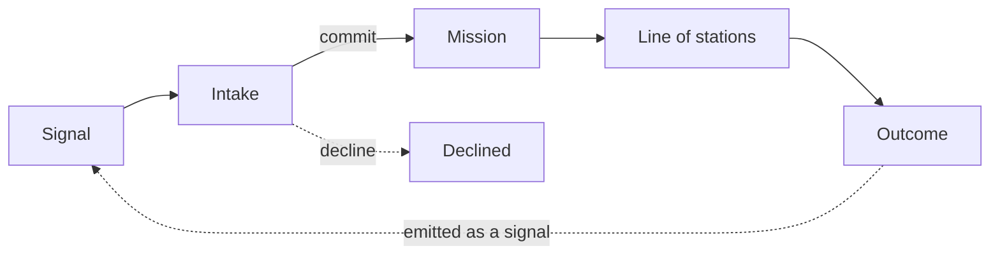
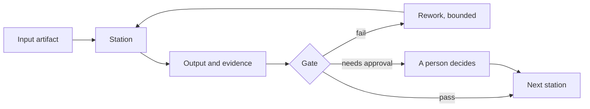

# Concepts

This page explains what an AI factory is and defines every word the library uses. A factory is a repeatable production system: signals come in, validated outcomes go out, and outcomes feed back as new signals. The library gives that loop a small set of typed parts. Read this page first; every other page builds on these definitions.

None of these types ships yet. Each one lands in its own pull request, with its own page, and this page links to them as they arrive.

## The loop

Work enters a factory one way only: as a **signal**. A signal is a piece of data from a person or a system. A request typed at a terminal is a signal. So is a failing health check.

**Intake** reads signals and decides. It either commits to a **mission** or declines, with a reason. A mission is what the factory promises to do, written so that success can be measured.

A mission runs along a **line** of **stations**. When the line ends, the **outcome** is emitted as a new signal. That closes the loop: what a factory produces can become what it works on next.

## Two questions, kept apart

An agent saying "done" tells you very little. So every station answers two separate questions.

| Question | Who answers | Possible answers |
|---|---|---|
| Did it run? | The station | It ran, or it did not run. |
| Did it pass? | The station's gate | Pass, fail, or needs approval. |

A **gate** is plain code. It reads recorded evidence and returns a decision with its reasons. A model may produce the evidence, for example a review report. A model never makes the decision.

Three rules follow, and the library enforces all of them.

1. **Missing evidence is "did not run", never "pass".** If a check could not run, the line stops and says so.
2. **"Did not run" never triggers rework.** Rework is for work that was judged and failed. An unreachable tool is not a failed design.
3. **A person approves an exact thing.** An approval names one artifact by its digest. If the artifact changes, the approval is void.

## Inside a line

A **station** is one bounded job with a typed input and a typed output. It may use one agent, several agents, or none. A station that only runs a formatter is as much a station as one that drafts a design.

What a station hands on is an **artifact**. An artifact is never edited. It carries a digest of its content, the station that produced it and the artifacts it was made from. A correction is a new artifact that names the one it replaces.

When a gate fails, the line may send work back, a fixed number of times. This is **rework**. At the limit the line either halts or carries on, as the line declares.

## Methodology

A **methodology** is a way of working, written down as data. It has a name, a version and three parts.

| Part | What it does |
|---|---|
| Kit | The Pydantic AI capabilities a station's agents are given. |
| Required evidence | What a station must produce, such as a review report. |
| Criteria | Plain code that judges that evidence at the gate. |

Because it can require evidence and shape a gate, a methodology is more than a prompt. Its name and version are stamped on every artifact and every gate decision. That record is what later lets two methodologies be compared on the same work.

## The vocabulary

These are the public types. Each will have its own page.

| Word | Meaning |
|---|---|
| Signal | The one typed way in: a piece of data from a person or a system. |
| Mission | What the factory commits to, with measurable success criteria and the signals it came from. |
| Factory | A frozen composition of lines and default methodologies. It holds no live state. |
| Line | An ordered route through stations, with bounded rework. |
| Station | One bounded job with typed input and output. An agent is optional. |
| Artifact | An unchangeable, content-addressed record of what a station handed on. |
| Gate | Plain code that judges recorded evidence and gives reasons. |
| Approval | A named person's decision on one exact artifact. |
| Methodology | A named, versioned way of working: kit, required evidence, criteria. |
| Run | The serialisable record of one mission moving along a line. It may be waiting on an approval. |

Some words are used in prose but are not types.

| Word | Meaning |
|---|---|
| Intent | A signal that a person wrote. It is a kind of signal, not a separate type. |
| Evidence | An artifact when a gate reads it. Evidence and artifacts share one record. |
| Outcome | The result of a run. It is emitted as a signal. |
| Kit | The list of capabilities a methodology or station supplies. |

Two words come from Pydantic AI and keep its meaning exactly.

| Word | Meaning |
|---|---|
| Capability | Pydantic AI's `AbstractCapability`: a reusable bundle of tools, hooks and instructions for an agent. |
| Agent | Pydantic AI's `Agent`. |

The spelling "artifact" matches the `Artifact` type. Everything else on this site uses British spelling.

## What a factory is not

- **Not an agent framework.** Pydantic AI is the agent framework. The factory is the layer above it that says what was produced, how it was judged and who approved it.
- **Not a workflow engine.** A line runs in-process. Durable execution arrives later as adapters, so the types here are not shaped by any one engine.
- **Not autonomous by default.** A person approves. The library records who, what and when.
