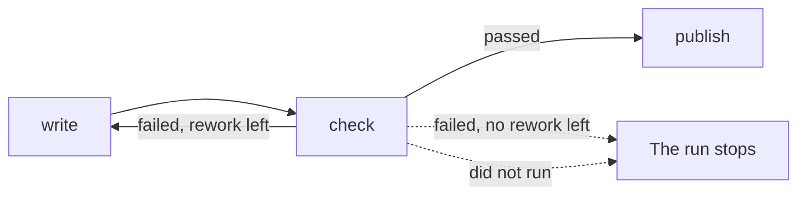

# Factories and rework

A factory is a named, ordered list of [stations](stations.md). Each station's output becomes the next station's input. When a station fails its [gate](gates.md), the factory can send the work back a fixed number of times; this is rework. This page shows how to declare a factory, run work through it and read the record of what happened.

A factory is plain data, and its `run` method does the work. It runs in-process: there is no server to start and no engine to install.

## At a glance

This is the factory the first example builds. Work moves forward on a pass. A failure sends it back while rework is left. A station that did not run stops the run.



## Declare and run a factory

This factory has three stations and no model. `write` produces a draft. `check` fails drafts with fewer than three words. `publish` gives the checked draft an address.

```python
import asyncio

from pydantic import BaseModel

from pydantic_ai_factory import (
    Artifact,
    Evidence,
    Factory,
    MemoryStore,
    Rework,
    StationContext,
    Verdict,
    failed,
    gate,
    passed,
    station,
)


class Brief(BaseModel):
    topic: str


class Draft(BaseModel):
    text: str


class Checked(BaseModel):
    text: str
    words: int


class Published(BaseModel):
    address: str


@station
async def write(ctx: StationContext, brief: Brief) -> Draft:
    # On rework, the gate's reasons arrive as feedback. Here they prompt a longer draft.
    if ctx.feedback:
        return Draft(text=f"A short guide to {brief.topic}")
    return Draft(text=brief.topic)


@gate(version="1")
def long_enough(output: Artifact[Checked], evidence: Evidence) -> Verdict:
    if output.payload.words < 3:
        return failed(f"only {output.payload.words} words; at least 3 are needed")
    return passed(f"{output.payload.words} words")


@station(gate=long_enough)
async def check(ctx: StationContext, draft: Draft) -> Checked:
    return Checked(text=draft.text, words=len(draft.text.split()))


@station
async def publish(ctx: StationContext, checked: Checked) -> Published:
    return Published(address=f"https://example.org/{checked.words}-words")


guide = Factory(
    "guide",
    [write, check, publish],
    rework=[Rework("check", "write", limit=2)],
)


async def main() -> None:
    store = MemoryStore()
    run = await guide.run(Brief(topic="tea"), store=store)

    print(run.outcome, run.finished)
    #> passed True
    for step in run.steps:
        print(step.station, step.attempt, step.outcome)
        #> write 1 not_judged
        #> check 1 failed
        #> write 2 not_judged
        #> check 2 passed
        #> publish 1 not_judged

    assert run.output is not None
    print((await store.get(run.output, Published)).payload.address)
    #> https://example.org/5-words


asyncio.run(main())
```

The first draft was one word, so `check` failed it. The rework rule sent the work back to `write`, which received the gate's reasons in `ctx.feedback` and wrote a longer draft. The second check passed and the work carried on.

## Rework

A rework rule says what happens when one station fails its gate.

```python test="skip"
Rework("check", "write", limit=2, on_limit="halt")
```

This block shows the shape only; the full example above runs it.

| Argument | Meaning |
|---|---|
| `from_station` | The station whose failure triggers the rule. |
| `to_station` | Where the work goes back to. It may be the same station or an earlier one. Leave it out to redo the failing station itself. |
| `limit` | How many times work may be sent back in one run. The default is 1. |
| `on_limit` | What to do when the limit is reached: `"halt"`, the default, or `"continue"`. |

When work is sent back, the work runs forward again from the target. The target runs on the same input artifact it had before, and gets the failing gate's decision as `ctx.feedback`, so it can act on the reasons. Its `ctx.attempt` goes up by one. Stations between the target and the failing station run again too, with no feedback of their own.

Three rules are worth knowing.

1. **Rework is only for failures.** A station that did not run is never sent back. The run stops and reports it. An unreachable tool is not fixed by redoing the work.
2. **A failure with no rule stops the run.** Nothing is retried unless you say so.
3. **Rework is always bounded.** There is no unlimited setting, and a limit counts for the whole run. If another rule sends the work back past a station, that station's rework budget is not refilled. So the total number of reworks in a run can never exceed the sum of the limits.

### Carrying on at the limit

With `on_limit="continue"`, work that has used up its rework moves on to the next station anyway. The failure is not forgotten. The station's result stays `failed`, and the run's outcome is `failed` even though it finished. The exception is when later rework sends the work back and the station passes on a later attempt: the run is judged on each station's last attempt. Use this when a later station is worth running on imperfect work, such as one that reports what went wrong.

## The record of a run

`Factory.run` returns a `Run`. It is a plain record that holds refs, so it can be saved, compared and sent elsewhere.

| Field | Meaning |
|---|---|
| `outcome` | `passed`, `failed`, `did_not_run` or `needs_approval`. A record passed to `on_step` while the run is under way says `running`. |
| `finished` | Whether the work reached the last station. |
| `stopped_at` | The station where the run stopped early, if it did. |
| `steps` | One station result per attempt, in the order they happened. |
| `input`, `output` | The refs of the first input and the final output. `output` is set only when the run finished. |
| `run_id`, `factory`, `factory_version` | Which run of which factory this was. |
| `factory_digest` | A digest of the factory's shape: its stations, gates and rework rules. |
| `mission_id`, `methodologies` | Where the run sits. These are stamped on every artifact it makes. |

`outcome` and `finished` are separate answers, as `ran` and `passed` are for a station.

| Outcome | `finished` | When |
|---|---|---|
| `passed` | `True` | The work reached the end and no station's last attempt failed. |
| `failed` | `False` | A station failed with no rework left, and the run halted. |
| `failed` | `True` | A station's last attempt failed, its rule said to carry on, and the work reached the end. |
| `did_not_run` | `False` | A station raised, returned the wrong type, or its gate could not be evaluated. |
| `needs_approval` | `False` | A gate asked for a person. The run waits there. |

When a run stops early, the artifact it stopped on is `run.latest(run.stopped_at).output`.

A station with no gate is `not_judged`, and the work moves past it. Such a run can end as `passed`: nothing failed. Give a station a gate when its output must be judged.

Two helpers read the steps for you.

| Call | Returns |
|---|---|
| `run.latest("check")` | The most recent result for that station, or `None` if it never ran. |
| `run.attempts("check")` | How many times it was attempted. |

## Lineage

Every station's output names its input, so a finished run is a chain you can walk backwards. The last sample on the [artifacts](artifacts.md#read-without-the-payload-class) page shows how to follow `inputs` without knowing each payload's class.

All the artifacts a run makes carry the same `run_id` in `produced_by`, with the station and the attempt.

## A badly formed factory is refused

A factory is checked when it is declared, not when it runs. If anything is wrong you get one `FactoryDefinitionError` whose `findings` list every problem at once.

```python
from pydantic import BaseModel

from pydantic_ai_factory import Factory, FactoryDefinitionError, Rework, StationContext, station


class Brief(BaseModel):
    topic: str


class Draft(BaseModel):
    text: str


class Published(BaseModel):
    address: str


@station
async def write(ctx: StationContext, brief: Brief) -> Draft:
    return Draft(text=brief.topic)


@station
async def publish(ctx: StationContext, published: Published) -> Published:
    return published


try:
    Factory("guide", [write, publish], rework=[Rework("review")])
except FactoryDefinitionError as error:
    for finding in error.findings:
        print(finding)
        #> 'write' hands on Draft but 'publish' takes Published
        #> rework from 'review': no such station
```

A factory is refused when:

- its name or version is empty, it has no stations, or two stations share a name;
- a station's output type is not the next station's input type;
- a rework rule names a station that is not in the factory, or a target that comes later;
- a rework rule has a limit below 1, an `on_limit` that is not `"halt"` or `"continue"`, or is declared twice for one station;
- a rework rule starts from a station with no gate, which can never fail.

## Saving progress

`Factory.run` returns its record when the run finishes or stops. If the store raises or the run is cancelled part-way, nothing is returned. To keep a record as you go, pass `on_step`. It is awaited after every attempt with the record so far.

```python test="skip"
async def save(progress: Run) -> None:
    path.write_text(progress.model_dump_json())


run = await guide.run(Brief(topic="tea"), store=store, on_step=save)
```

This block shows the shape only, because it writes a file. A record holds refs and plain data, so `model_dump_json` and `Run.model_validate_json` round-trip it exactly.

## Passing dependencies

`Factory.run` takes one `deps` object and gives it to every station as `ctx.deps`. Use it for clients, settings and agents, and pass a fake in tests.

## What comes next

A run that stops at `needs_approval` cannot yet be resumed. That is the next page: a person's decision, bound to the exact artifact they approved.
